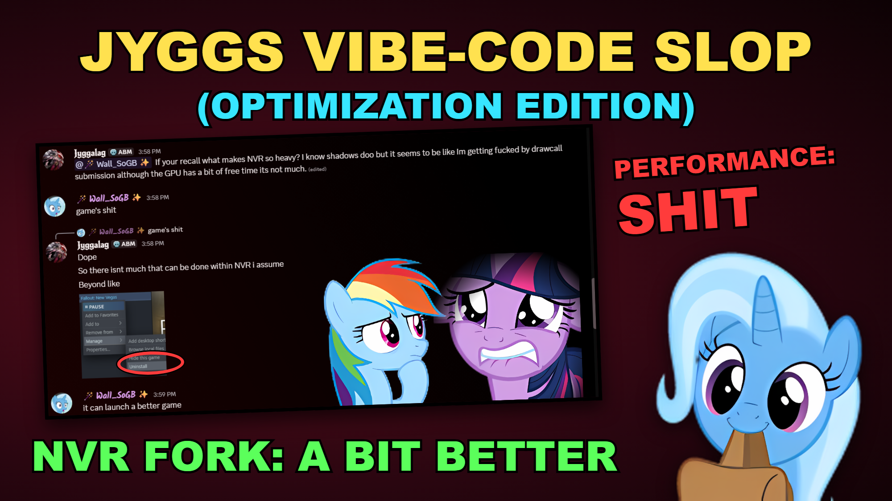

# NVR Unofficial Jyggs Vibecoded Slop v1.2



An unofficial side build of **New Vegas Reloaded 4.4.1** for Fallout: New Vegas.

I love how 4.4.1 looks, I just didn't love how it ran on my modlist. Every door into a lamp-lit interior froze the game for
over a second, and outside I was stuck in the 50s on a card that should do a lot better. So this build keeps the 4.4.1
picture and goes after the cost: the stalls, the per-frame overhead, and a settings menu you can actually use with a mouse.

The one thing that does change the picture is `PerformancePreset`, and it's **on by default**. It trims the sun and lamp
shadows (shorter range, a bit softer, fewer tiny objects casting them) for roughly 2 ms back per frame. Since 1.2 two small terrain shortcuts
(`IsoHeightTaps`, `ParallaxLite`) are on by default too and change the picture slightly. Don't want any of that? Switch
them off on the menu's Performance page and you have the full 4.4.1 picture again. Your own settings are never touched.

## New in 1.2

- **Menu redone.** Search, Save and Revert sit in a fixed bar at the top, the sidebar resizes, long names don't get cut
  off any more, and tables with several columns scroll sideways instead of squashing.
- **Typing works.** On some setups the menu never got key presses from Windows, so you couldn't type values. It now
  reads the keyboard the same way the game does.
- **Keybinds page.** Every hotkey (menu, Locations window, save, occlusion toggle, screenshot...) can be rebound in the
  menu: hit Rebind, press the new key. It warns you if a key is already taken.
- **Preset values are editable.** Rows set by the Performance preset used to be greyed out. Now you can change them;
  your value is saved as your own override of the preset, and Reset puts the preset's value back.
- **Locations window (Delete key).** A preset manager for your Cartographer INIs: create, copy, edit and delete
  presets, see every cell and worldspace that uses one, and hit **Go** to teleport there.
- **More speed work, on by default:** built-in occlusion culling (Conor's Occlusion Culling 1.2.3), terrain
  `SkipEmptyLayers`, and `HiddenObjectCulling`. Numbers below.

Full list in [CHANGELOG.md](CHANGELOG.md).

## The door freeze is gone

This was the big one for me. Cartographer sets NVR's values with scripts every time you change cells, and each of those
calls rebuilt NVR's whole settings table. On Mojave Outpost that was 95 rebuilds per door, over a full second of frozen
game!

Now script calls get batched into one rebuild per frame, and better still, Cartographer's job is built right into the DLL.
Location presets get applied during the loading screen instead of after you're already standing in the room.

| | Before | After |
|---|---|---|
| Script settings calls (`BatchScriptSettings`) | 95 reloads, 1060-1100 ms, worst frame ~1100 ms | 1 reload, 11-13 ms, worst frame 45-52 ms |
| Built-in Locations (no Cartographer.esp) | worst frame 45-52 ms | worst frame ~34 ms, no frame over 50 ms |
| Locations apply, faster lookups | 26.8 ms, worst frame at WastelandNV 222 ms | 7.7-12 ms, worst frame ~34 ms |

Your Cartographer preset mods (Mojave Nights NVR and friends) keep working, since the DLL reads the same
`Data\Config\Cartographer` files. Just disable `Cartographer.esp` itself and set
`[_Main.Main.Locations] Enabled = true` in your toml (it's off by default). More on that in
[docs/REQUIREMENTS.md](docs/REQUIREMENTS.md).

## Faster frames

Most of the per-frame savings come from the **UNOFFICIAL Boutique fork by CountessAshe and Winston**, which this build sits
on top of. They measured it on a GTX 1070 at 1440p with 4.4.1's default settings:

| Scene | 4.4.1 | Boutique |
|---|---|---|
| Lamp-lit casino interior | 24.7 ms (40.5 FPS) | 15.8 ms (63.1 FPS) |
| Desert at noon | 27.8 ms (36.0 FPS) | 19.7 ms (50.7 FPS) |

What each of their changes does is in [docs/UNOFFICIAL-4.4.1-BOUTIQUE.md](docs/UNOFFICIAL-4.4.1-BOUTIQUE.md).

On top of that I added a few sun shadow tricks. `PartialShadowAtlasUpdate` and `SharedShadowWalk` keep the same picture
and are always on. `SpreadLod` spreads the far shadow update out so you don't get a spike every 4th frame, and it comes
with the preset. I haven't measured them one by one yet, so I'm not putting numbers on them.

And the preset: on my RX 7900 XTX it took NVR's own GPU time from about **6.2 to 4.0 ms** per frame in the Wasteland. That's
one card in one area, so if you benchmark it on yours, I'd love to see the results!

New in 1.2, measured on my RX 7900 XTX with DXVK in the Wasteland (Mojave Outpost), flipping one setting on and off in
the same spot:

| | Off | On |
|---|---|---|
| Built-in occlusion culling | 22.00 ms (45.5 FPS) | 19.68 ms (50.8 FPS), about +12% FPS |
| Terrain `SkipEmptyLayers` | 21.74 ms | 21.57 ms, -0.18 ms |
| `IsoHeightTaps` | 18.37 ms | 18.64 ms, no measurable gain |
| `ParallaxLite` | 19.45 ms | 19.36 ms, about -0.1 ms (noise level) |
| `HiddenObjectCulling` | | no measurable difference outdoors |

**Your mileage may vary.** I tested these quickly, in one or two spots, on one PC, not across lots of cells. How much you
get depends on the cell, your GPU and CPU and your settings, and some of these didn't show a gain where I tested them.
Interiors and the Strip/Freeside weren't measured for the 1.2 features at all.

Everything I've measured, with where and how, lives in [docs/OPTIMIZATIONS.md](docs/OPTIMIZATIONS.md). If I didn't
measure something, it says so.

## DXVK (optional, but wow)

Honestly, the biggest jump on my PC wasn't NVR at all. Swapping AMD's D3D9 driver for DXVK took me from 52-56 FPS to about
130 in the same build, because the native driver was choking on draw calls. NVR's own passes cost 2.4-4 ms either way.

It's included in [`DXVK (optional)/`](DXVK%20(optional)), the unmodified official DXVK 3.1.1 with its license. You need a
GPU with Vulkan 1.3, and I've only tried it on my AMD card. If the game won't start or something looks off, delete the two
files and you're back to normal.

My `dxvk.conf` makes the launcher report the same AMD GPU as the game. DXVK only does that for `FalloutNV.exe` on its own,
so the launcher saw your real card and could pick different settings.

## Install

Grab the zip from [Releases](https://github.com/Jyggalag999/Jyggs-Vibe-code-Slop-Optimization-Edition/releases). It's
the whole thing, DLL, shaders and textures, so you don't need the official NVR files. Install it like any other mod with
your mod manager (or unzip it into `Data`), and disable or remove any other NVR so they don't overwrite each other. The End
key opens the menu and Delete opens the Locations window; both can be changed on the menu's Keybinds page.

Updating from another NVR build? Keep your `NewVegasReloaded.dll.toml`, the zip doesn't include one. On a fresh install the
game makes it for you from the defaults.

For DXVK, grab the separate DXVK zip from the same release and copy `d3d9.dll` and `dxvk.conf` next to `FalloutNV.exe`.

**Preset not kicking in?** If you ran an earlier build of this fork, your toml might already say
`PerformancePreset = false`. Flip it on in the menu and it sticks.

**Can I use it with the official NVR or the Boutique build?** Not at the same time. Same DLL name, so this one replaces them.

**Game won't reach the main menu?** Since 1.1 you get a popup if the defaults toml or the shader folder is missing, which
means only part of the zip got installed. If it still won't start, set `StartupLog = true` under `[_Main.Main.Profiler]` in
`NewVegasReloaded.dll.toml` and send me `NewVegasReloaded.log` and your `CrashLogger.log`. The last `[Startup]` line shows
where it stopped.

## Compile it yourself

You'll want Windows, Visual Studio 2019 (Build Tools is fine) with the C++ x86 toolset and Windows SDK, and git. Run these
from a "Developer Command Prompt for VS 2019":

```powershell
git clone --recurse-submodules https://github.com/Jyggalag999/Jyggs-Vibe-code-Slop-Optimization-Edition.git
cd Jyggs-Vibe-code-Slop-Optimization-Edition
msbuild TESReloaded.sln -t:Restore -p:RestorePackagesConfig=true
msbuild TESReloaded.sln -target:NewVegasReloaded /property:Configuration=Release /property:Platform=x86 -m
```

The first msbuild line grabs the D3DX9 NuGet package, and `toml11` comes in as a submodule. You end up with
`NewVegasReloaded\Release\NewVegasReloaded.dll`. The defaults file is `resource\NewVegasReloaded.dll.defaults.toml`, and
`build.bat "NewVegasReloaded" "C:/DeployFolder/"` does the build and copies everything to a folder for you.

## Credits and license

This is **not** an official NVR build, and the NVR / TESReloaded team has nothing to do with it. Please don't ask them for
help with it, open an issue here instead!

All the real heavy lifting is theirs: New Vegas Reloaded / TESReloaded by Alessio Tamburini (Alenet), maintained by Llde,
with the NVR team and everyone in [License.md](License.md), and the 4.4.1 release by pr0bability. The performance base is
CountessAshe and Winston's Boutique fork, itself a port of
[NVR UNOFFICIAL Optimized](https://github.com/adeesababa/NVR-Unofficial-Optimized). [WallSoGB](https://github.com/WallSoGB)'s
IDA database made the engine digging possible. [DXVK](https://github.com/doitsujin/dxvk) is by Philip Rebohle and
contributors (zlib/libpng license, see `DXVK (optional)/LICENSE-DXVK.txt`). Dear ImGui, toml11 and the rest of `lib/` keep
their own licenses.

Same license as the original: GPL-3.0 with the extra terms in [License.md](License.md), provided as is. Builds have to keep
a custom name and can't be sold.

The original NVR 4.4.1 / Boutique readme is still here: [docs/README-NVR-441-and-Boutique.md](docs/README-NVR-441-and-Boutique.md).
